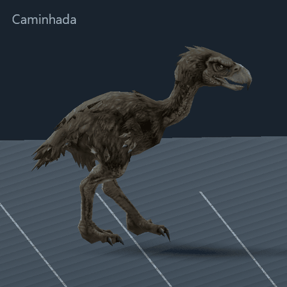
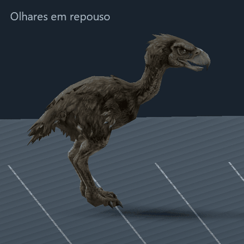
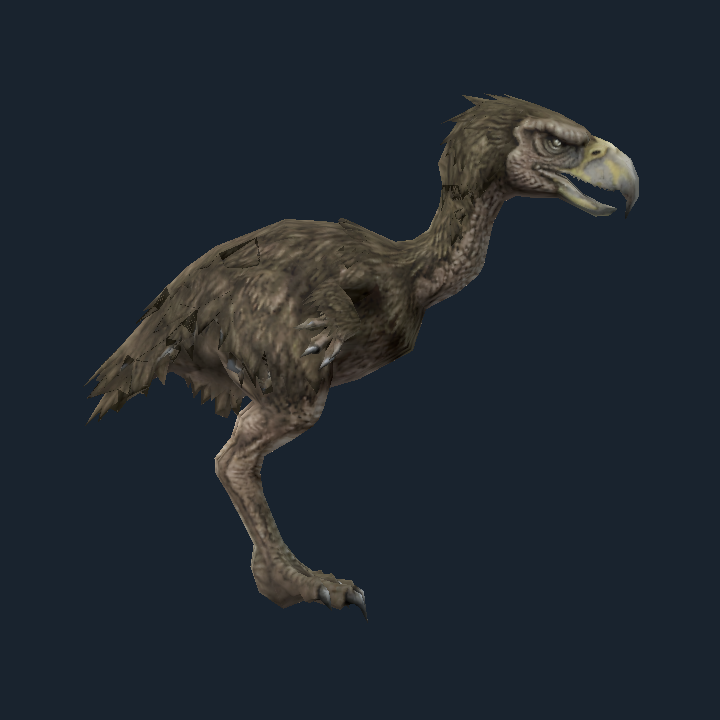
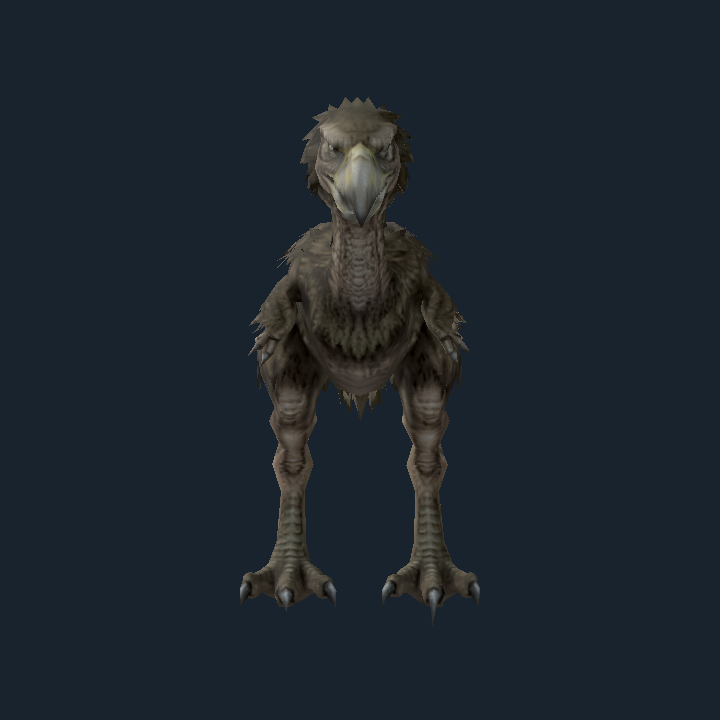

# Keleken — rig, animações e instância de estudo

Pesquisa, implementação e revisão em 12/10/2026. A pesquisa original está preservada abaixo; o estado implementado é o desta seção.

## Implementado e como ver

Abra `executar-exterior.cmd`: há um Keleken na estrada, próximo ao ponto inicial. A patrulha usa X −1,55…1,55 / Z 15,5…21,0; R/Reiniciar o reposiciona. O controlador evita destinos ocupados e respeita os colisores. A camada 2 impede o inimigo de acionar as zonas de câmera do jogador. Após o pedido de completar combate, ele também percebe, persegue e ataca Dylan, e pode morrer por tiros. Regras e testes em [COMBAT.md](COMBAT.md). O estudo isolado abaixo permanece sem IA de combate.

Para escolher todos os clipes e girar a câmera, abra `executar-keleken.cmd`. Teclas 1–7 ou botões selecionam o clipe, ←/→ giram a câmera, a opção “Mover sobre o piso” liga o deslocamento físico e Esc sai.

**Origem real das animações:** clipes originais autorados por código em `tools/rig_keleken.py` e baked no Blender. Não foram usados clipes de Mesh2Motion, Mixamo ou dos pacotes comerciais pesquisados. O rig também é customizado, criado diretamente pela API do Blender; não foi gerado pelo addon Rigify. Isso é distinto das opções pesquisadas e recomendadas inicialmente.

A primeira versão tinha cabeça rígida e passada mecânica. Após o feedback do usuário, idle/look foram refeitos com olhares rápidos, pausas e inclinações, e a caminhada recebeu recuo/avanço do pescoço, compensação da orientação da cabeça, passos menores, levantamento menor do pé e flexão dos dedos no balanço. As pausas do wander entram em momentos variados do idle. Esta revisão continua sendo animação autorada de protótipo, sem captura de movimento.

| Artefato | Conteúdo |
| --- | --- |
| `assets/models/keleken/source/keleken_rig.blend` | Fonte editável, textura empacotada, 24 ossos de deformação e 8 controles de pés/jarretes/dedos/direção dos joelhos. Pernas por IK de dois segmentos até o jarrete; tarso acompanha o pé; cabeça/pescoço em FK |
| `assets/models/keleken/keleken_animated.glb` | Malha/textura preservadas, skin de até quatro influências, 24 ossos e sete clipes baked a 30 fps; controles/constraints não vão para o runtime |
| `animation_manifest.json` | Lista de ossos, FPS, clipes, velocidades e hash do original |
| `actors/keleken/keleken.tscn` | Corpo físico, colisão independente, visual e marcador do bico preso à cabeça |
| `actors/keleken/keleken_visual.gd` | Ciclos locais por instância, blends de 0,16 s, cadência ligada à velocidade, retorno dos gestos a idle |
| `actors/keleken/keleken_wander.gd` | Passeio temporário no exterior com pausas e limites |

Altura da cópia de estudo: 2,4 m, base no chão e frente −Z. Pode ser ajustada no visual. O original `model_base.glb` permanece com SHA-256 `1748ED72AFC6B5E1F85C2DF601AFA2A0D5C1790418F0BD3C0655B65B53EE8376`. A textura deriva dos mesmos bytes JPEG embutidos nele. Origem/licença da malha continuam conforme o inventário, sem nova conclusão nesta implementação.

| Clipe | Duração | Uso |
| --- | --- | --- |
| idle | 6,4 s | Repouso com olhares e inclinações; loop |
| walk | 1,2 s | Caminhada, apoio de 60%; velocidade nativa de 1,0 m/s na escala de estudo |
| run | 0,8 s | Corrida, apoio de 42%; velocidade nativa de 2,8 m/s |
| look | 2,4 s | Olhares rápidos para os dois lados; loop |
| alert | 1,2 s | Ameaça com asas/pescoço |
| attack_beak | 1,0 s | Antecipação, golpe e retorno; janela de acerto apenas registrada no manifesto |
| recover | 1,0 s | Recuperação |

Nenhuma hitbox de ataque ou IA predatória foi instalada. O IK é usado para autoria/bake; não existe IK de terreno em execução. Os pés foram validados no piso plano da cena de estudo e a instância exterior permanece no trecho plano da estrada. As penas e a anatomia do modelo ainda limitam o acabamento visual.

### Validação da versão revisada

O probe mede o esqueleto/skin exportados e o deslocamento físico real, não somente os controles da fonte. Última validação direta: 24 ossos, sete clipes, zero falhas. Os giros da cabeça exportados abrangem 28,8° no idle, 37,3° no look e 13,2° na caminhada; o pescoço avança/recua 8,8 cm na caminhada. Deslizamento máximo do apoio no deslocamento físico: 0,0211 m/s na caminhada e 0,0465 m/s na corrida. Pesos, textura, orientação, duração, emendas e retorno dos gestos a idle passaram.

Wander foi ensaiado por três minutos simulados, com três seeds, conferindo movimento, pausas, limites, chão, câmera e reinício. Percurso exterior e transição de porta também foram reexecutados. Capturas e GIFs em `docs/evidence/keleken`; logs locais em `.local/tests`.





### Reproduzir e editar

O Blender portátil 4.5.3 LTS foi obtido no site oficial e fica em `.tools`, ignorado pelo Git. Ele só é necessário para regerar/editar a fonte; o jogo carrega o GLB.

```powershell
& '.tools/blender-4.5.3/blender-4.5.3-windows-x64/blender.exe' --background --factory-startup --python-exit-code 1 --python tools/rig_keleken.py
& '.tools/godot-4.7.2/Godot_v4.7.2-stable_win64_console.exe' --headless --path . --editor --import --quit
& '.tools/godot-4.7.2/Godot_v4.7.2-stable_win64_console.exe' --headless --path . --script res://tests/run_all.gd -- --only=keleken-animacao,keleken-wander,exterior-geometria,dylan-portas,cenas
& '.tools/godot-4.7.2/Godot_v4.7.2-stable_win64_console.exe' --path . --script res://tools/preview_keleken_animation.gd
```

Para editar à mão, abra o `.blend`, selecione a ação `CTRL_idle`, `CTRL_walk` etc. e ajuste os controles/ossos em Pose Mode. Atenção: executar novamente o gerador reconstrói a fonte e os clipes a partir do código, substituindo edições manuais naquele caminho. Salve uma cópia de trabalho separada se fizer ajustes à mão.

## Pesquisa original e opções de biblioteca

## Recomendação

Manter a malha atual e preparar um rig de ave no Blender. Fazer primeiro uma prova de deformação e contato dos pés; só depois produzir o conjunto de clipes. Há duas rotas úteis:

- **Sem compra:** experimentar o esqueleto Bird do Mesh2Motion e seus clipes Idle/Walk. Adaptar e corrigir no Blender, autorando corrida, alerta e ataque. É uma base para protótipo, com proporções de ave voadora.
- **Com biblioteca de movimentos terrestres:** avaliar o pacote Ostrich Animated de DreamPlayStudios como doador de animações. Seu catálogo cobre caminhada, corrida, ataques e morte. Retargetar no Blender ou adaptar o esqueleto do doador à malha, sempre corrigindo pose de repouso, pesos e contatos. Não é compatibilidade comprovada com o nosso GLB.

Para um rig independente de bibliotecas, usar Rigify como ponto de partida gratuito, ou Auto-Rig Pro se já houver acesso ao addon. Escolher a fonte de movimentos antes de fechar o esqueleto reduz retrabalho. O número e os eixos dos ossos do pescoço, pernas e asas precisam ser conciliados com essa fonte.

## Estado do modelo do projeto

Arquivo: `assets/models/keleken/model_base.glb`. Grafia do diretório preservada.

| Propriedade | Verificação direta |
| --- | --- |
| Tamanho e hash | 1.160.188 bytes; SHA-256 `1748ED72AFC6B5E1F85C2DF601AFA2A0D5C1790418F0BD3C0655B65B53EE8376` |
| Gerador declarado | `https://tripo3d.ai` no campo `asset.generator`; isso não identifica a conta de origem nem estabelece licença |
| Geometria | 1 nó de malha, 1 primitive, 4.425 vértices exportados, 9.090 índices = 3.030 triângulos |
| Aparência | 1 material, UVs, textura JPEG embutida; material de dupla face |
| Rig e skinning | Sem `skins`, sem atributos `JOINTS_0`/`WEIGHTS_0`; Godot confirma zero Skeleton3D e zero pesos |
| Animações | Sem `animations`; Godot confirma zero AnimationPlayer |
| Transformação | Escala uniforme de nó ≈ 1,25644; caixa importada ≈ X 1,253988 × Y 1,200000 × Z 0,542331 |
| Base e direção | Base em Y ≈ −0,619632; frente +X confirmada nas vistas; a escala física desejada ainda precisa ser definida |

A malha é leve e permite iniciar uma prova de rig sem redução adicional de polígonos. Isso não comprova que sua topologia de articulações deforme bem. Não houve auditoria completa de conectividade/manifold, skinning experimental nem teste de abertura/fechamento do bico.

Inspeção visual: pernas separadas, juntas dobradas na pose-base, pescoço alongado, cabeça volumosa, bico aberto, asas pequenas recolhidas e detalhes de penas na superfície. Asas próximas ao tronco e penas são pontos prováveis de influência indevida dos pesos automáticos. O bico inferior precisa de influência própria; olhos não foram identificados como objetos separados.





## Bibliotecas verificadas

Não foi localizada nesta pesquisa uma biblioteca gratuita específica de Kelenken com locomoção e ataques completos. Foram encontradas ferramentas e modelos animados de anatomia próxima. As diferenças de passada e proporção exigem adaptação.

| Opção | O que a fonte oferece | Avaliação para o nosso modelo |
| --- | --- | --- |
| [Mesh2Motion](https://mesh2motion.org/) | Rig Bird; exportação GLB/FBX; assets CC0 e código MIT. Na aplicação, Bird tinha exatamente cinco entradas: Flap, Glide, Idle, Rest Pose e Walk | Melhor primeira experiência gratuita. Rest Pose é pose de referência, não comportamento. Não há Run, ataque, reação ou morte no catálogo Bird observado. Modelos de referência: Seagull e Bald Eagle |
| [3D Ostrich Animated — DreamPlayStudios](https://www.highend3d.com/3d-model/3d-ostrich-animated-3d-model) | Dez clipes: Beak Poke Attack, Bite Attack, Jump Poke Attack, Jump Feet Claw Attack, Idle 1/2/3, Run, Walk e Death. Anúncio informa 64 ossos, FBX e Blender | Candidato mais completo para movimentação terrestre e combate. Pescoço, cabeça, asas e dedos diferem; precisa de retarget e correção. Pacote comercial, não adquirido nem testado |
| [Terror Bird Phorusrhacos — virtual-creator](https://www.cgtrader.com/3d-models/animal/bird/terror) | 936 quadros incluindo corrida, alimentação e caminhada; o anúncio informa FBX com ossos, skinning e animação já amostrada | Candidato de silhueta mais próxima. Não confundir 936 quadros com 936 clipes. A página aberta avisa que o `.blend` não tem rig/animação e mostra indisponibilidade, enquanto o resultado de busca mostra compra; confirmar disponibilidade e conteúdo do FBX antes de escolher |
| [Animated Cassowary — GAMICO](https://www.fab.com/listings/02972431-fe3a-433b-b5fa-fd8e0e7bca94) | Anúncio declara mais de 30 animações baked e formato GLB | Anatomia terrestre interessante. A lista individual de clipes não aparece no texto consultado; não assumir que cobre os comportamentos do jogo. Não adquirido nem testado |

O catálogo Bird foi conferido diretamente em [app.mesh2motion.org](https://app.mesh2motion.org/), incluindo a prévia Walk, em 12/10/2026; versão exibida `git:b04ee333b-release`. Não foi enviado o modelo do usuário. Os arquivos Blender de rigs/animações estão no [repositório oficial de assets](https://github.com/Mesh2Motion/mesh2motion-assets). Licenças e formatos são declarações das fontes, não aprovação dos assets para o projeto.

**Mixamo não é a rota recomendada:** a Adobe limita o auto-rigger e a biblioteca a humanoides bípedes e cita asas/caudas como possíveis problemas. Ser bípede não torna esta ave um humanoide adequado ao serviço. Fonte: [FAQ oficial do Mixamo](https://helpx.adobe.com/in/creative-cloud/faq/mixamo-faq.html).

## Como fazer o rig

### 1. Preparar uma cópia de trabalho

Importar o GLB no Blender e salvar um `.blend` separado. Aplicar a escala do nó antes de vincular malha/esqueleto; definir altura de jogo, alinhar a frente, apoiar os pés no chão e deixar a raiz centralizada. O Godot usa Y para cima; na exportação, verificar a conversão de eixos do Blender. A frente de gameplay atual é −Z.

Inspecionar juntas, base do pescoço, separação do bico inferior e penas. Corrigir somente a geometria que falhar nos ensaios. Não é necessário desfazer UVs ou trocar a textura para adicionar um rig. Separar temporariamente penas/asa pode ajudar no skinning quando o peso atravessa superfícies próximas.

### 2. Esqueleto de deformação

Proposta inicial de aproximadamente **25–35 ossos**, como orçamento de projeto, ajustável após a inspeção das articulações e a escolha do doador:

| Região | Cadeia e propósito |
| --- | --- |
| Raiz | `root` no chão e `pelvis` para centro de massa; movimento global separado do balanço do corpo |
| Tronco | 2–3 ossos entre pelve e peito para inclinação e respiração |
| Pescoço | 3–5 segmentos, com controle de cabeça que possa compensar o movimento do corpo |
| Cabeça/bico | Cabeça e mandíbula inferior; parte superior do bico acompanha a cabeça |
| Pernas | Cadeia por lado de coxa, segmento até o jarrete, tarso e apoio/dedos; posicionar as juntas conforme a malha |
| Asas | 2–3 ossos por lado para abertura curta, ameaça e equilíbrio |
| Cauda | 2–3 ossos para compensação e movimento secundário |
| Dedos | Controle conjunto inicialmente; ossos adicionais somente se contato/ataque exigir |

A articulação de ave que aparece dobrando para trás corresponde ao jarrete/tornozelo. Evitar impor a cadeia e o comportamento de joelho humano à silhueta. Validar a cadeia na vista lateral antes de pintar pesos.

### 3. Controles para animar

- **Pés por IK:** manter o apoio parado enquanto pelve e tronco se deslocam. Usar controles de direção da dobra e pivôs de apoio dos dedos. Para a cadeia de ave, adaptar o solver às articulações existentes, em vez de presumir uma perna humana de dois segmentos.
- **Cabeça independente:** pescoço em FK, ou controles IK/FK se necessário, permitindo olhar lateral, ameaça e golpe com o bico. Preservar o volume da base do pescoço.
- **Asas e cauda em FK:** controles simples; este personagem não precisa de rig de voo completo.
- **Rig de animação separado do rig exportado:** controles, constraints e drivers ficam no Blender; os movimentos são baked nos ossos de deformação que serão exportados.

Rigify permite montar rigs por partes e fornece cadeias com IK/FK. A proposta é adaptar um metarig de ave e simplificar as asas, ou montar essas partes manualmente. Fonte: [manual de tipos de membros do Rigify](https://docs.blender.org/manual/en/3.0/addons/rigging/rigify/rig_types/limbs.html). Esse manual descreve uma versão anterior; conferir os parâmetros na versão de Blender escolhida. A disponibilidade histórica do metarig Bird está registrada nas [notas oficiais do Blender](https://developer.blender.org/docs/release_notes/2.79/add_ons/).

Alternativa paga: Auto-Rig Pro oferece ossos de asas, exportação Universal para esqueletos não humanoides e exportação FBX/GLTF com suporte declarado ao Godot. Fontes: [recursos e alterações](https://www.lucky3d.fr/auto-rig-pro/doc/updates_log.html), [exportação para engines](https://www.lucky3d.fr/auto-rig-pro/doc/ge_export_doc.html). É uma ferramenta de rig/exportação; não resolve a autoria dos clipes por si só.

### 4. Skinning e deformação

Começar com pesos automáticos quando possível, depois corrigir manualmente. Prioridades: nenhuma perna puxar a outra; asas não puxarem o peito; pescoço não arrastar o bico inteiro; mandíbula não mover o crânio; penas não abrirem frestas durante flexão. Preferir transições suaves nas juntas e influência rígida em bico/garras. Limitar a quatro influências por vértice é uma opção de simplicidade/portabilidade, não um requisito demonstrado deste projeto.

Fazer poses extremas de agachamento, passo longo, giro da cabeça, golpe e abertura/fechamento do bico antes de animar ciclos completos. Se a superfície colapsar, corrigir pesos primeiro e adicionar geometria local apenas quando isso não bastar.

### 5. Reaproveitar movimentos

Existem duas operações distintas: vincular a malha ao esqueleto escolhido e transferir animação entre esqueletos. Nomes de ossos iguais, sozinhos, não garantem compatibilidade; hierarquia, pose de repouso e eixos também importam.

Com Mesh2Motion, ajustar o rig Bird, testar Idle/Walk e exportar uma cópia; preservar sua estrutura enquanto os clipes forem usados. Com um doador comercial, importar o FBX no Blender, mapear pelve/pernas/pescoço/cabeça/mandíbula, transferir e fazer bake. Corrigir a passada com os pés no solo; não copiar o deslocamento absoluto do quadril de uma ave de tamanho diferente. Se a cadeia do pescoço ou das pernas tiver quantidade diferente de ossos, distribuir a rotação e resolver o contato pelos controles do alvo.

## Conjunto de clipes para o jogo

Proposta de autoria, não conteúdo já disponível:

| Prioridade | Clipes | Função |
| --- | --- | --- |
| Primeira prova | `idle`, `walk`, `run` | Comprovar skinning, escala, apoio e cadência |
| Encontro P2 | `look`, `alert`, `turn_left`, `turn_right` | Investigação, identificação do jogador, ameaça e mudança de direção |
| Agressão | `attack_beak`, `recover` | Antecipação legível, golpe e janela de recuperação |
| Reação/combate | `hit`, `death`; chute opcional | Complementar somente quando o comportamento exigir |

Usar vídeos de aves terrestres como referência artística de passada e equilíbrio; adaptar ao peso e à cabeça do modelo. Não declarar que uma captura de avestruz reproduz exatamente o comportamento de uma espécie extinta. Para o personagem, priorizar corpo inclinado na corrida, cabeça controlada e ameaça legível nas câmeras fixas.

## Integração proposta no Godot

Exportar um GLB com skin, esqueleto e clipes baked, inicialmente a 30 fps. Manter `.blend`, biblioteca de origem e GLB derivado em caminhos separados do arquivo-base.

Cena sugerida: `CharacterBody3D` com colisão independente da malha, nó visual, `Skeleton3D`, `AnimationPlayer` e `AnimationTree`. Estados da IA futura comandam os clipes; locomotion faz blend de idle/walk/run. A IA/percepção não pertence ao rig.

Começar com clipes **in place**, com deslocamento/rotação controlados pelo ator físico, como no Dylan. Medir a velocidade nativa de cada ciclo na escala escolhida e regular a cadência pela velocidade real para reduzir patinação. Para ataques, disparar a janela de acerto pelo tempo da animação e prender o ponto do bico por `BoneAttachment3D`; colisão corporal e hitbox de ataque são elementos separados.

Preferir retarget e correção no Blender para exportar clipes já compatíveis. Se a biblioteca precisar ser compartilhada dentro do Godot, usar `BoneMap` e `SkeletonProfile` próprios para ave. Não usar `SkeletonProfileHumanoid` como atalho. O manual permite perfis próprios e alerta que nomes e Bone Rest devem coincidir para compartilhar animações. Fonte: [retargeting oficial do Godot](https://docs.godotengine.org/en/stable/tutorials/assets_pipeline/retargeting_3d_skeletons.html).

## Critérios da primeira prova

1. GLB importado tem Skeleton3D, pesos e clipes esperados, sem deformação ao entrar na pose-base.
2. Idle/Walk/Run não puxam membros vizinhos nem abrem a superfície nas penas/juntas.
3. Pés mantêm apoio plausível, sem escorregar nas velocidades previstas; troca de clipe não desloca a criatura.
4. Frente visual coincide com direção comandada; tamanho, base no chão e colisão são consistentes.
5. Cabeça, ameaça e golpe são legíveis nas câmeras do exterior, e o alcance do bico acompanha a pose.

Verificado nesta pesquisa: conteúdo estrutural do GLB, importação/render em Godot 4.7.2, três vistas inspecionadas, hash preservado, catálogo Bird e anúncios/fontes acima. A execução gráfica teve avisos de acesso ao log/cache `user://` e ao armazenamento de certificados, mas retornou código 0 e gerou as vistas. Não foram verificados: deformação com rig, retarget do nosso modelo, arquivos dos pacotes comerciais, qualidade dos loops ou desempenho da criatura animada.
