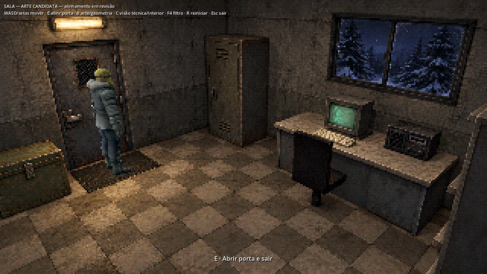
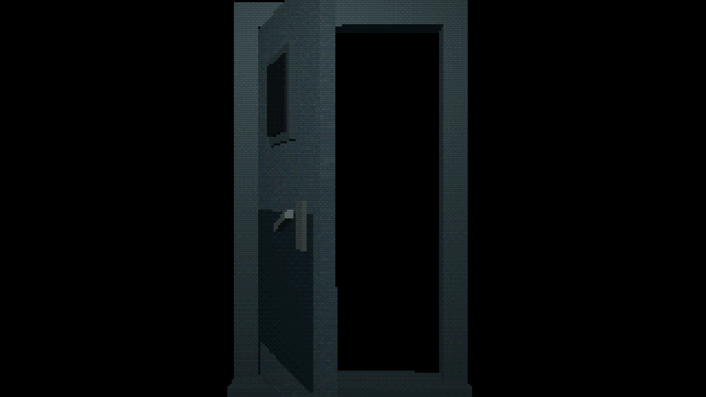

# Apresentação PSX / CRT

Implementada em 11/10/2026. Abra `executar-exterior.cmd` ou `executar-sala.cmd`. O modo inicial é **PSX**. **F4** percorre PSX → PSX + CRT → Original; um aviso aparece por 2,5 segundos. A escolha dura a sessão e acompanha o exterior, a sala e a porta. Durante a sequência da porta, a entrada fica bloqueada e o modo escolhido é preservado.

| Modo | Apresentação |
| --- | --- |
| Original | Imagem completa, sem pós-processamento retrô |
| PSX | Amostragem nearest em 320×180, 32 níveis por canal RGB e dithering ordenado Bayer 4×4 |
| PSX + CRT | Mesmo tratamento, com scanlines estáveis e vinheta discreta |

É uma aproximação visual adaptada à composição 16:9 existente. Não emula o hardware, o jitter de vértices ou a interpolação afim de texturas do console. O efeito é aplicado após o cenário e o ator serem compostos: não reduz a resolução real de renderização 3D, não desloca as câmeras e não altera colisões. Textos, prompts, menu e diagnóstico continuam em resolução normal. Usar Original para inspecionar detalhes de calibração.

## Integração

- `systems/rendering/retro_filter.tscn` fica depois de Background/Actors na composição base; as cenas derivadas recebem o efeito.
- `retro_filter.gdshader` usa uma grade local à área útil e amostragem estável; barras pretas ficam fora do filtro. Não há ruído temporal nem oscilação de brilho.
- `retro_filter.gd` compartilha a seleção entre instâncias e atualiza origem/extensão da área útil no redimensionamento. Cada instância possui seu próprio ShaderMaterial.
- A transição possui a mesma cena de filtro, dentro do quadro da porta, abaixo da cortina de fade. Um BackBufferCopy explícito por composição garante que a porta leia sua própria imagem, mesmo com o cenário ainda presente. O quadro e o filtro são ocultados juntos durante os fades de saída/chegada.

## Verificação

Godot 4.7.2 oficial, Windows, Forward+/Vulkan, NVIDIA RTX 4050 Laptop GPU. **7 probes, zero falhas**, incluindo `filtro-retro`, `dylan-portas`, `dylan-portas-grafico`, `composicao`, `oclusao`, `renderizacao` e `operacao`.

O teste gráfico novo usa eventos F4 reais, confere rejeição de repetição, diferenças entre modos, restauração exata da imagem original e manutenção da escolha em uma nova cena. Verifica centenas de pixels virtuais em 1280×720, 1920×1080 e janela 1280×960: zero blocos inconsistentes e barras preservadas. A ida/volta pela porta verifica a seleção CRT no close e após cada troca de cena. O teste de renderização continuou sem emendas nos oclusores das três câmeras.

```powershell
& '.tools/godot-4.7.2/Godot_v4.7.2-stable_win64_console.exe' --headless --path . --script res://tests/run_all.gd -- --only=composicao,oclusao,renderizacao,operacao,dylan-portas,dylan-portas-grafico,filtro-retro
```

Capturas inspecionadas, sem alterações, em `docs/evidence/retro/`; resumo da execução em `regression-summary.txt`. O teste gera novas comparações em `.local/retro-{original,psx,crt}.png`. Esta entrega não inclui nova exportação nem medição de desempenho.

### Original


### PSX



### PSX + CRT


### Porta com CRT


